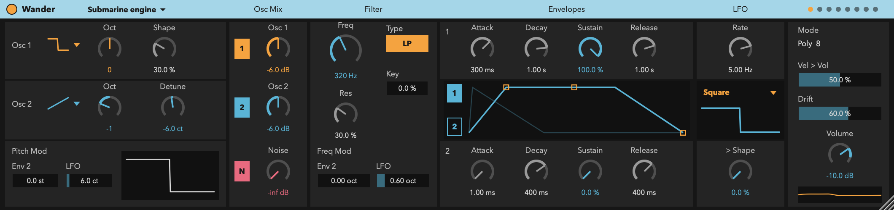

# Wander

A free eight-voice synthesiser in the spirit of "two oscillators, a filter and some drift", laid out
like Ableton's Drift. VST3 and AU for macOS (Apple Silicon and Intel), VST3 for Windows, a standalone
app, and a JSFX version for REAPER.



**Download:** [Releases](https://github.com/pavel-konrad/wander/releases/latest), installation steps
in each zip (`INSTALL.txt`) and below.

## What is inside

```
 Osc 1 ─┐
 Osc 2 ─┼─ Osc Mix ─► Filter (LP / HP / BP) ─► Amp ─► out
 Noise ─┘                ▲                      ▲
                Env 2, LFO, key, drift        Env 1
```

- **Osc 1, Osc 2:** sine, triangle, saw, pulse (saw and pulse anti-aliased with PolyBLEP); octave,
  shape (pulse width), detune.
- **Osc Mix:** a level for each oscillator and for noise.
- **Filter:** a state-variable filter (low-, high-, band-pass) with resonance, key tracking, and
  modulation from envelope 2 and the LFO.
- **Envelopes:** 1 shapes the level, 2 modulates the filter and the pitch.
- **LFO:** five shapes (sine, triangle, saw, square, random) to pitch, filter and pulse width.
- **Drift:** every voice wanders a little in pitch and cutoff on its own, like an old analog synth.
- **Presets:** Init, Bass, Pad, Sonar ping, Submarine engine, Sea, Steam, Knock (menu in the header).

## Install

| System | Plugin | Where it goes |
|---|---|---|
| macOS | `Wander.vst3` | `~/Library/Audio/Plug-Ins/VST3/` |
| macOS | `Wander.component` (AU, Logic) | `~/Library/Audio/Plug-Ins/Components/` |
| Windows | `Wander.vst3` (a folder) | `C:\Program Files\Common Files\VST3\` |
| REAPER (any system) | `wander-synth.jsfx` | REAPER's resource path (*Options > Show REAPER resource path*) `Effects/Kurz/` |

**macOS:** Wander is not signed with an Apple Developer ID, so macOS blocks it after downloading. Run
once in Terminal:

```
xattr -dr com.apple.quarantine ~/Library/Audio/Plug-Ins/VST3/Wander.vst3 ~/Library/Audio/Plug-Ins/Components/Wander.component
```

Then restart the DAW. **Ableton Live:** *Settings > Plug-Ins > Use VST3 Plug-In System Folders* on,
*Rescan*; the browser lists it under *Plug-Ins > Pavel Konrad > Wander*. Drop it on a MIDI track.

**REAPER, JSFX version:** also copy `wander-synth.presets.ini` to REAPER's `presets/` folder as
`js-Kurz_wander-synth_jsfx.ini` (exactly this name).

### Instalace (česky)

1. Stáhni zip pro svůj systém z [Releases](https://github.com/pavel-konrad/wander/releases/latest).
2. **Mac:** `Wander.vst3` zkopíruj do `~/Library/Audio/Plug-Ins/VST3/`, `Wander.component` do
   `~/Library/Audio/Plug-Ins/Components/` (ve Finderu *Otevřít > Otevřít složku…* a vlož cestu).
   Pak jednou v Terminálu příkaz `xattr …` z odstavce výš, jinak ho macOS zablokuje.
   **Windows:** složku `Wander.vst3` zkopíruj do `C:\Program Files\Common Files\VST3\`.
3. Restartuj DAW. V Abletonu: *Nastavení > Plug-Ins > Use VST3 Plug-In System Folders* zapnout,
   *Rescan*, pak *Plug-Ins > Pavel Konrad > Wander* přetáhnout na MIDI stopu.

## Build

```
git clone https://github.com/pavel-konrad/wander && cd wander
cmake -B build -DCMAKE_BUILD_TYPE=Release        # fetches JUCE 8.0.4, or uses external/JUCE if present
cmake --build build --config Release --target Wander_VST3 Wander_AU Wander_Standalone
```

The build copies the plugins into the system folders (`-DWANDER_COPY_PLUGIN=OFF` to skip). A tag
`v*` makes GitHub Actions build macOS (universal) and Windows, run pluginval (strictness 5) on both
and publish the zips as a release.

Checks used during development:

| Tool | What |
|---|---|
| `wander_render PRESET OUT.wav NOTE,START,LENGTH ...` | the sound without JUCE or a host; pitch and level compared with the JSFX version |
| `wander_snapshot OUT.png [--preset N]` | the editor drawn to a PNG without a host |
| `auval -v aumu Wndr Pkon`, pluginval | the AU and VST3 validators |

`src/Synth.cpp` and `jsfx/wander-synth.jsfx` are the same algorithm; the JSFX is the readable one
taught in a course (`06_course/sound-synthesis.course`, lesson 02). Parameters and presets are in the
same order in both (`src/Params.h`), so a recipe works in either.

## Notes on JSFX (found while writing it)

- EEL2 has no scientific notation: `1e12` does not parse, and the section it is in silently stops
  compiling. Write `1000000000`. Hex is `$x90`, not `0x90`.
- `@gfx` runs beside the audio and shares its variables: everything in the GUI is prefixed `g_`.
- A change made in the GUI does not run `@slider`; derived values are recomputed in `@block`.

## Licence

Wander's code by Pavel Konrád; the licence for it is not chosen yet. It is built with JUCE 8, which
is available under the AGPLv3 or the JUCE licence (see juce.com).
